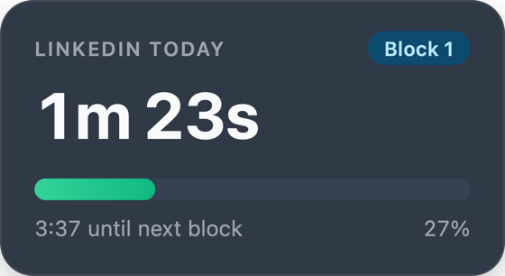
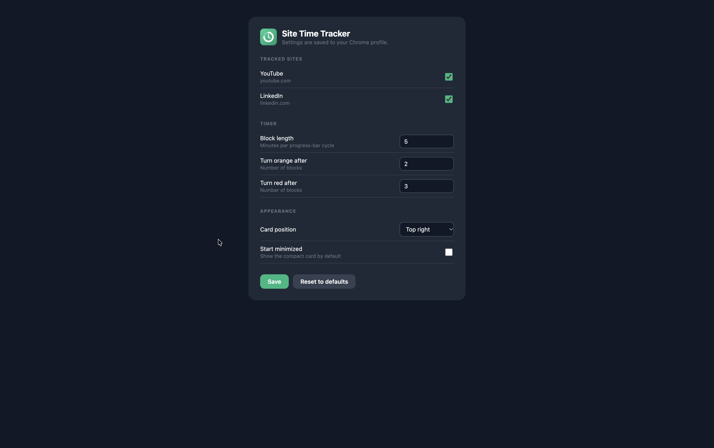

# Site Time Tracker

A small Chrome extension (Manifest V3) that shows a floating card with how much time you've spent **today** on YouTube and LinkedIn, with a progress bar that fills every 5 minutes.

## Screenshots

<p>
  
  &nbsp;&nbsp;
  
</p>



## Features

- Floating card with total time today, a 5-minute progress bar, a block counter and a countdown to the next block
- Bar colour shifts from green to orange to red as the day's total grows (by default after 2 and 4 blocks)
- Time is saved per site and per day, so it survives page refreshes, new tabs and browser restarts
- Only counts time while the tab is visible
- Resets automatically at local midnight
- Click the card to minimize or expand it. The compact card's background follows the state (green / orange / red).
- Settings page (click the toolbar icon): enable or disable each site, block length, colour thresholds, card position, start minimized
- Light and dark mode (follows your system setting)
- Time data stays on your machine in `chrome.storage.local`. Settings are stored in `chrome.storage.sync` (your Chrome profile). Nothing is sent to any other server.

## Install (from source)

1. Clone this repo:
   ```bash
   git clone https://github.com/yasanthaniroshan/site-time-tracker
   ```
2. Open `chrome://extensions` in Chrome.
3. Turn on **Developer mode** (top right).
4. Click **Load unpacked** and select the project folder (the one containing `manifest.json`).
5. Open YouTube or LinkedIn. The card appears in the top-right corner.

After changing code, click the reload icon on the extension's card in `chrome://extensions`, then refresh the page you're testing on.

## Project structure

```
.
├── manifest.json          # Extension manifest (MV3)
├── README.md
├── icons/                 # Extension icons (icon.svg is the source)
└── src/
    ├── background.js      # Opens the settings page when the toolbar icon is clicked
    ├── content/
    │   ├── config.js      # Tracked sites, default settings, settings load/save
    │   ├── widget.js      # Floating card UI (shadow DOM)
    │   └── tracker.js     # Time tracking and storage logic
    └── options/
        ├── options.html   # Settings page
        └── options.js
```

The three content scripts share one global scope and are loaded in the order listed in `manifest.json`. They communicate through a `SiteTimer` namespace, which the settings page also uses.

## Customize

**Change settings:** click the extension's toolbar icon to open the settings page. Changes apply instantly to open tabs.

**Track another site:**
1. Add `{ name: "Reddit", domain: "reddit.com" }` to `SITES` in `src/content/config.js`.
2. Add `"*://*.reddit.com/*"` to `content_scripts.matches` in `manifest.json`.
3. Reload the extension.

## Known limitations

- If the same site is visible in two windows at once (for example side by side), both add time, so it double counts.
- Tabs that were open before you reloaded the extension keep running the old script until refreshed.

## Contributing

Contributions are welcome. See [CONTRIBUTING.md](CONTRIBUTING.md) and the [Code of Conduct](CODE_OF_CONDUCT.md). Report security issues as described in [SECURITY.md](SECURITY.md).

## License

[MIT](LICENSE)
